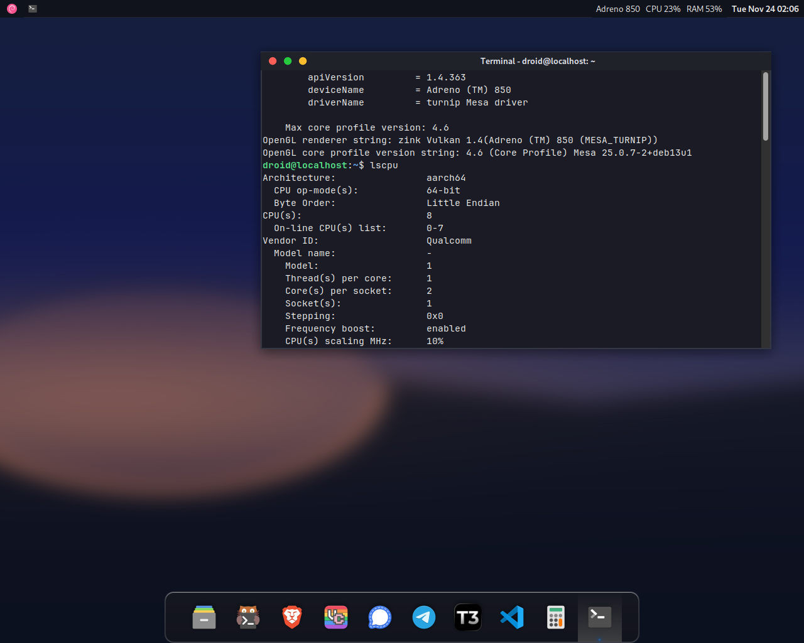
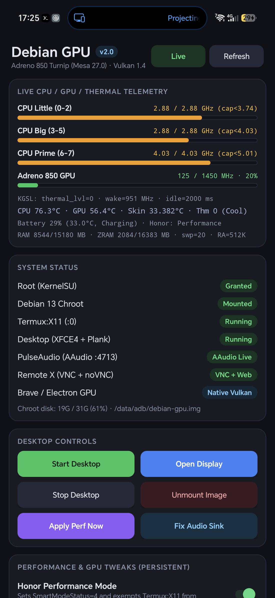

# Debian 13 Native Desktop on Adreno 850 (Honor Magic9 Pro Max)

Run a full native **Debian 13 (`trixie`, `arm64`)** glibc Linux desktop on a rooted Qualcomm Snapdragon 8 Elite Gen 5 / **Adreno 850** phone (tested on **Honor Magic9 Pro Max**) with bare-metal **Vulkan 1.4 (Mesa 26.3.1 Turnip over KGSL)** and **OpenGL 4.6 (Mesa Zink)** — zero VM overhead, zero `proot` syscall translation, and SELinux left `Enforcing`.



## What You Get

- **Bare-metal Adreno 850 GPU acceleration** directly on `/dev/kgsl-3d0`:
  - **Vulkan 1.4** via upstream-patched **Mesa Turnip** (`chip_id=0x44051431`, KGSL `gen8_14_0`), compiled natively for glibc inside Debian and installed to `/opt/turnip-a850`.
  - **OpenGL 4.6 (Core & Compatibility)** via **Mesa Zink** running over Turnip.
  - **Native Vulkan for Brave & Electron apps** (`Skia GaneshVulkan` + `ANGLE Vulkan 1.4` directly on Turnip, bypassing Zink for **+29%** WebGL FPS).
  - Zero KGSL page faults in `dmesg`; SELinux remains `Enforcing`.
- **Android audio bridge (YouTube & Linux apps):**
  - Auto-starts **Termux PulseAudio** (`module-aaudio-sink` + localhost TCP on `127.0.0.1:4713`) with `PULSE_SERVER=127.0.0.1` exported into Debian so browsers (Brave/Chromium) and desktop apps play real 48 kHz audio without stalling HTML5 `<video>`.
- **Persistent CPU / GPU / Memory performance tweaks:**
  - Stored in `/data/adb/debian-gpu.conf` and re-applied automatically on start and on phone reboot via KernelSU `/data/adb/service.d/99-debian-gpu-perf.sh`: Adreno 850 max clock unlock (`1450 MHz`) & fast KGSL ramp-up (`+24%` FPS), Honor Performance Mode (`SmartModeStatus=4`) + `Termux:X11` background exemption, WALT CPU burst tuning, **tuned `jemalloc 5.3` (`3.7×` faster multi-threaded allocations than `glibc`)**, **THP `defer+madvise` + ARM64 64 KB CONT-PTE** (eliminates synchronous compaction stutters), XFCE4 shadow removal + `XPresent` sync, and RAM/loop read-ahead tuning.
- **macOS-style dark desktop (XFCE4 + Plank)**:
  - Slim translucent dark top bar (Debian Whisker Menu + active window menu on left; live GPU/CPU/RAM badge, systray, and clock on right).
  - Centered frosted-glass floating dock (**Plank**) with 145% hover zoom, running-app dots, and a 9-dot App Grid launcher.
  - Custom `MacOS-Dark` `xfwm4` window theme with 4x supersampled red/yellow/green traffic-light buttons on the top-left and a generated dark dusk wallpaper.
  - **System-wide dark mode** across GTK3, GTK4/libadwaita, Qt, Chromium, and Electron via `xdg-desktop-portal-gtk` (`org.freedesktop.appearance` `color-scheme = prefer-dark`), `GTK_THEME=Adwaita:dark`, and `QT_QPA_PLATFORMTHEME=gtk3`.
- **Local & remote display**:
  - On-device (and USB-C to DisplayPort external monitor) via **Termux:X11** (`DISPLAY=:0`).
  - Remote desktop via **TigerVNC** (`x0vncserver`, port `5900`) and **noVNC** browser client (port `6080`), bound strictly to `127.0.0.1` and your **Tailscale** IP (never public Wi-Fi).
- **Clean isolated storage**:
  - 32 GB sparse `ext4` loop image (`/data/adb/debian-gpu.img`, ~3 GB actual disk usage) mounted `rw,suid,dev,exec` so `sudo` works normally, plus phone storage bind-mounted at `/mnt/android`.

## Measured Performance (Honor Magic9 Pro Max, 1280x720)

| Path | Renderer / API | `glmark2` / `vkmark` (FPS) | Score |
|---|---|---|---:|
| **Debian 13 chroot Turnip + Zink (offscreen)** | `Adreno (TM) 850` / GL 4.6 | `build` **964**, `phong` **743**, `texture` **724**, `terrain` **88** | **628** |
| **Native Turnip on Termux:X11 (on-screen)** | `Adreno (TM) 850` / Vulkan 1.4 | `cube` **118**, `vertex` **109**, `phong` **100** (~120 Hz cap) | **109** |
| **Native Turnip + Zink on Termux:X11 (on-screen)** | `Adreno (TM) 850` / GL 4.6 | `texture` **77**, `phong` **64**, `build` **62**, `terrain` **49** | **62** |
| **Brave WebGL2 shader (Native Vulkan vs Zink)** | `ANGLE Vulkan 1.4 (Turnip)` | **159.6 FPS** vs 123.9 FPS Zink (**+29%**) | — |
| **KGSL Fast Ramp (`default_pwrlevel` + `idle_timer`)** | `Adreno (TM) 850` / `glmark2` | `phong` **166 FPS** vs 134 FPS stock (**+24%**) | **165** |
| **Multi-threaded Allocator (6 threads)** | `jemalloc 5.3` (tuned) vs `glibc` / `mimalloc 3.0` | **33.5 ms** vs 122.7 ms `glibc` (**3.7×**) / 45.3 ms `mimalloc` | — |
| VM `virgl` TCP bridge (for comparison) | `virgl (Adreno 850)` / GL 3.3 | `terrain` 29, `refract` 24 | 25 |
| VM software `llvmpipe` (for comparison) | CPU | `terrain` 10 | 9 |

---

## Repository Layout

```text
.
├── android-app/                        # Zero-Gradle Android manager app source (Java 11 + Android SDK)
│   ├── AndroidManifest.xml             # v2.0.0 (com.debiangpu.manager)
│   ├── build.sh                        # Builds & signs DebianGPU.apk (~58 KB) via aapt2 + javac + d8
│   ├── res/                            # Dark theme + macOS-style launcher icons
│   └── src/com/debiangpu/manager/
│       └── MainActivity.java           # Live CPU/GPU/thermal telemetry, 11 persistent toggles, audio & VNC controls
├── apk/
│   └── DebianGPU.apk                   # Prebuilt signed Android manager APK v2.0 (~58 KB)
├── assets/
│   ├── desktop-screenshot.png          # Live desktop screenshot from Honor Magic9 Pro Max
│   └── apk-v2-screenshot.png           # Live Debian GPU v2.0 Android manager screenshot
├── config/
│   └── turnip-a850.sh                  # /etc/profile.d/turnip-a850.sh GPU + PulseAudio environment profile
├── docs/
│   └── architecture-and-troubleshooting.md
├── patches/
│   └── mesa-26.3.1-adreno-850.patch    # 1-line Mesa 26.3.1 Adreno 850 (0x44051431) KGSL patch
└── scripts/
    ├── setup-termux.sh                 # Step 0: Termux packages (termux-x11, pulseaudio, socat, zstd)
    ├── 01-prepare-host.sh              # Step 1: Download Debian 13 + Mesa, patch, push via ADB
    ├── 02-bootstrap-chroot.sh          # Step 2: Create ext4 image, extract, mount, trigger build
    ├── 03-install-and-build-chroot.sh  # Step 3: Install XFCE4/Plank/VNC, build glibc Turnip
    ├── setup-macos-desktop.sh          # Generates wallpaper, traffic-light xfwm4 theme, Plank dock
    ├── debian-gpu.sh                   # Installed to /data/adb/debian-gpu.sh (daily manager + perf/audio/telemetry)
    └── verify-gpu.sh                   # Verifies Vulkan 1.4, OpenGL 4.6, CPU, optional glmark2
```

---

## Prerequisites

1. **Rooted Android phone** with a Qualcomm Adreno 850 (Snapdragon 8 Elite Gen 5) or another Turnip-supported KGSL Adreno GPU, and at least ~6 GB free space on `/data`.
2. **Termux** (from [F-Droid](https://f-droid.org/packages/com.termux/) or GitHub — do not use the outdated Play Store build).
3. **Termux:X11** companion APK (`com.termux.x11` from [termux/termux-x11 releases](https://github.com/termux/termux-x11/releases)).
4. **ADB** on your host PC (`curl`, `tar`, `xz`, `patch`, and optionally `zstd` for faster transfer).
5. *(Optional)* **Tailscale** installed on the phone if you want remote VNC / noVNC access over your tailnet.
6. *(Optional)* **USB-C to DisplayPort** cable (or USB-C hub) + keyboard/mouse for desktop monitor use.

---

## Quick Start (Automated 3-Step Install)

### Step 0 — Prepare Termux on the phone

Open **Termux** on your phone (normal non-root session) and run:

```bash
pkg update -y && pkg upgrade -y
pkg install -y x11-repo
pkg install -y termux-x11-nightly pulseaudio socat zstd
mkdir -p "$PREFIX/tmp/.X11-unix"
```

*(Or push and run `scripts/setup-termux.sh` inside Termux.)*

### Step 1 — Download, patch Mesa 26.3.1, and push from your PC

Clone this repo on your Linux/macOS host, connect your phone over ADB (USB or wireless), and run:

```bash
git clone https://github.com/bonald/debian-adreno850-desktop.git
cd debian-adreno850-desktop
./scripts/01-prepare-host.sh
```

If you have multiple ADB devices, pass the serial as the first argument:

```bash
./scripts/01-prepare-host.sh 192.168.1.50:5555
```

This downloads the latest Debian 13 (`trixie`) `arm64` rootfs and upstream `mesa-26.3.1.tar.xz`, applies [`patches/mesa-26.3.1-adreno-850.patch`](patches/mesa-26.3.1-adreno-850.patch), packs trimmed archives, and pushes everything to `/data/local/tmp/debian-gpu-setup/`.

### Step 2 — Bootstrap chroot, compile glibc Turnip, and configure the desktop

Run the on-device bootstrap script as root (this takes ~5–10 minutes on-device, compiling Mesa Turnip across all 8 cores):

```bash
adb shell su -c "sh /data/local/tmp/debian-gpu-setup/02-bootstrap-chroot.sh"
```

### Step 3 — Start the desktop and verify GPU acceleration

```bash
adb shell su -c "/data/adb/debian-gpu.sh start"
adb shell su -c "/data/adb/debian-gpu.sh verify --bench"
```

Termux:X11 will open on your phone with the live macOS-style XFCE4 + Plank desktop. You should see:
- `deviceName = Adreno (TM) 850` / `driverName = turnip` / `Vulkan 1.4`
- `OpenGL renderer string: zink Vulkan 1.4(Adreno (TM) 850 (MESA_TURNIP))`
- `OpenGL core profile version string: 4.6`

---

## Step-by-Step Manual Walkthrough

If you prefer to understand or run each step manually instead of using the automated scripts:

<details>
<summary>Expand full manual build instructions</summary>

### 1. Patch Mesa 26.3.1 for Adreno 850

Upstream Mesa 26.3.1 knows Adreno 840 (`0xffff44050A31`) but not yet Adreno 850 (`0x44051431`, KGSL `gen8_14_0`). Adding one line to `src/freedreno/common/freedreno_devices.py` enables hardware Turnip on Adreno 850:

```diff
 add_gpus([
         GPUId(chip_id=0xffff44050A31, name="Adreno (TM) 840"),
+        GPUId(chip_id=0x44051431, name="Adreno (TM) 850"), # KGSL gen8_14_0
     ], A6xxGPUInfo(
         CHIP.A8XX,
```

Apply it cleanly with:
```bash
tar -xJf mesa-26.3.1.tar.xz
patch -d mesa-26.3.1 -p1 < patches/mesa-26.3.1-adreno-850.patch
```

### 2. Create and mount the 32 GB sparse `ext4` image on Android (as root)

```sh
IMG=/data/adb/debian-gpu.img
MNT=/data/local/debian-gpu

truncate -s 32G "$IMG"
mke2fs -t ext4 -F -L debian-gpu "$IMG"
mkdir -p "$MNT"
LOOP=$(losetup -f)
losetup "$LOOP" "$IMG"
mount -t ext4 -o rw,suid,dev,exec,noatime "$LOOP" "$MNT"
```

### 3. Extract Debian 13 (`trixie`, `arm64`) and bind-mount host interfaces

```sh
tar --numeric-owner -xJf debian-trixie-arm64.tar.xz -C "$MNT"
mkdir -p "$MNT/proc" "$MNT/sys" "$MNT/dev" "$MNT/tmp/.X11-unix" "$MNT/mnt/android"
mount -t proc proc "$MNT/proc"
mount -t sysfs sysfs "$MNT/sys"
mount --bind /dev "$MNT/dev"
# Note: create /dev/pts and /dev/shm AFTER binding /dev
mkdir -p "$MNT/dev/pts" "$MNT/dev/shm"
mount --bind /dev/pts "$MNT/dev/pts"
mount -t tmpfs -o rw,nosuid,nodev,mode=1777 tmpfs "$MNT/dev/shm"
mount --bind /data/data/com.termux/files/usr/tmp/.X11-unix "$MNT/tmp/.X11-unix"
mount --bind /storage/emulated/0 "$MNT/mnt/android"

printf "nameserver 1.1.1.1\nnameserver 8.8.8.8\n" > "$MNT/etc/resolv.conf"
printf "127.0.0.1 localhost debian-gpu\n::1 localhost\n" > "$MNT/etc/hosts"
echo 'APT::Sandbox::User "root";' > "$MNT/etc/apt/apt.conf.d/99no-sandbox"
```

### 4. Create user + Android network groups inside chroot

```bash
groupadd -g 3003 -f aid_inet
groupadd -g 3004 -f aid_net_raw
usermod -aG aid_inet,aid_net_raw root
useradd -m -s /bin/bash -u 1000 -G sudo,video,render,aid_inet,aid_net_raw droid
echo "droid:droid" | chpasswd
echo "droid ALL=(ALL) NOPASSWD: ALL" > /etc/sudoers.d/droid
chmod 440 /etc/sudoers.d/droid
```

### 5. Compile glibc Mesa 26.3.1 Turnip (KGSL, X11) inside chroot

Use `-Dplatforms=x11` (Debian 13's `wayland-scanner` rejects Mesa 26.3.1's newer `wayland-protocols` 1.49 XML):

```bash
cd /src/mesa-26.3.1
meson setup build --prefix=/opt/turnip-a850 \
  -Dbuildtype=release -Db_ndebug=true \
  -Dplatforms=x11 \
  -Dvulkan-drivers=freedreno -Dfreedreno-kmds=kgsl \
  -Dgallium-drivers= -Dopengl=false -Degl=disabled -Dgbm=disabled -Dglx=disabled \
  -Dgles1=disabled -Dgles2=disabled -Dllvm=disabled -Dxmlconfig=disabled \
  -Dvalgrind=disabled -Dlibunwind=disabled -Dvulkan-layers= -Dtools= -Dmesa-clc=auto
ninja -C build -j8
ninja -C build install
```

### 6. Configure GPU environment (`/etc/profile.d/turnip-a850.sh`)

```bash
export VK_ICD_FILENAMES="/opt/turnip-a850/share/vulkan/icd.d/freedreno_icd.aarch64.json"
export MESA_LOADER_DRIVER_OVERRIDE=zink
export GALLIUM_DRIVER=zink
export TU_DEBUG="${TU_DEBUG:-noconform,noubwc}"
export MESA_VK_WSI_DEBUG="${MESA_VK_WSI_DEBUG:-sw}"
export QT_X11_NO_MITSHM=1
export GTK_THEME="${GTK_THEME:-Adwaita:dark}"
export QT_QPA_PLATFORMTHEME="${QT_QPA_PLATFORMTHEME:-gtk3}"
export DISPLAY="${DISPLAY:-:0}"
export PULSE_SERVER="${PULSE_SERVER:-127.0.0.1}"
```

For Chromium/Electron wrappers (Brave, VS Code, Vesktop, Signal, T3 Code), `/data/adb/debian-gpu.sh` also manages `/etc/profile.d/chromium-gpu-flags.sh` (`--ignore-gpu-blocklist --enable-gpu-rasterization --enable-zero-copy --enable-features=Vulkan --use-gl=angle --use-angle=vulkan`) when `PERF_CHROMIUM_VULKAN=1`.

### 7. Apply the macOS-style XFCE4 + Plank configuration and install `/data/adb/debian-gpu.sh`

Run [`scripts/setup-macos-desktop.sh`](scripts/setup-macos-desktop.sh) inside the chroot, copy [`scripts/debian-gpu.sh`](scripts/debian-gpu.sh) to `/data/adb/debian-gpu.sh`, and start with `su -c "/data/adb/debian-gpu.sh start"`.

</details>

---

## Android Manager App (`Debian GPU v2.3`)

Instead of typing `su -c "/data/adb/debian-gpu.sh ..."` every time, you can manage the desktop, audio bridge, and performance tweaks from a lightweight (~60 KB, zero-Gradle) Android app (`com.debiangpu.manager`):

<p align="center">
  
</p>

- **Live CPU / GPU / Thermal Telemetry (auto-refreshes every 2.5s, toggleable `Live` / `Paused`):**
  - Real-time frequency meters for **CPU Little (0–2)**, **CPU Big (3–5)**, **CPU Prime (6–7)** (highlighted amber whenever capped below hardware max), and **Adreno 850 GPU** (`MHz / 1450 MHz · busy%`).
  - Live KGSL state (`thermal_lvl`, wake clock, `idle_timer`), live HAL **CPU / GPU / Skin temps**, Android thermal status, battery/charging state, Honor power mode, **RAM / ZRAM / swappiness / loop read-ahead**, plus a warning banner when Honor Launcher is capping CPU clocks. *(Tip: leaving Debian GPU open on the phone screen while docked prevents Honor's home-screen CPU cap.)*
- **Expanded System Status Badges:** Root (KernelSU `su -M`), Debian Chroot mount & disk usage, Termux:X11 (`:0`), XFCE4 + Plank desktop, **PulseAudio (`AAudio Live` / `Null Sink`)**, Remote X (VNC + noVNC), and **Brave / Electron GPU (`Native Vulkan` / `Zink GL`)**.
- **One-tap Desktop & Audio Controls:** Start Desktop (auto-opens Termux:X11), Open Display, Stop Desktop, Unmount Image, **Apply Perf Now**, and **Fix Audio Sink** (repairs `AAudio_sink` and routes active streams).
- **15 Persistent Performance & GPU Toggle Switches** (saved in `/data/adb/debian-gpu.conf` and auto-applied on reboot via KernelSU `/data/adb/service.d/99-debian-gpu-perf.sh`), plus **Restore Stock Defaults**:
  - Honor Performance Mode (`SmartModeStatus=4` + `Termux:X11` background exemption)
  - Unlock Adreno 850 Max Clock (`thermal_pwrlevel=0`, 1450 MHz)
  - GPU Fast Ramp (`951 MHz` wake + `500 ms` idle timer, +24% FPS) & GPU Max Wake (`1450 MHz` docked)
  - **Unlock 8 Cores & Disable FAS Cap** (`core_ctl` keeps all 8 cores including both 5.01 GHz Prime cores active, disables `honor_fas` 2.4 GHz clamp)
  - **Docked Thermal Mode** (pauses Honor's 40 °C `dubaid` skin daemon & `hn_thermal` `cooling_switch`, keeping `iawareperf` UI boost + Qualcomm HW 105 °C CPUCP/LMh protection intact)
  - WALT Burst Tuning (`hispeed_load=70`, `pl=1`) & **WALT Prime-Bias** (`cluster0/1` upmigrate `95% → 40/45%` + `sched_asymcap_boost=1` for faster single-core & browser bursts)
  - RAM & Chroot Disk I/O (`swappiness=20`, `vfs_cache_pressure=50`, loop `read_ahead_kb=512`)
  - **THP Defrag Fix (`defer+madvise`, 2 MB `madvise`, ARM64 64 KB CONT-PTE `always`)**
  - **Tuned `jemalloc 5.3` Allocator** (`3.7×` faster for desktop/Mesa/shells; safely excluded from Chromium PartitionAlloc)
  - XFCE4 No Shadows + `XPresent` sync
  - Native Vulkan (`GaneshVulkan` + `ANGLE Vulkan`, +29% WebGL) for Brave & Electron apps
  - PulseAudio Bridge (`AAudio :4713`) & Auto-Apply on Reboot (`service.d`)
- **Remote X & Quick Tools:** Auto-detects your Tailscale IP (Copy noVNC, Copy VNC, Open Web, Change VNC Password), Launch Terminal, **Launch Brave**, Verify GPU (`vulkaninfo` + `glxinfo`), **Restart VNC**, Fix AVF Terminal Audio, and a clearable Console Output view.

### Install the Prebuilt APK

```bash
adb install apk/DebianGPU.apk
```

*(Or copy [`apk/DebianGPU.apk`](apk/DebianGPU.apk) to your phone and install it directly.)*

On first launch, grant Superuser access to **Debian GPU** in **KernelSU Manager** or **Magisk**, then tap **Refresh**.

### Build the APK from Source (No Gradle Required)

Requires JDK 11+, Android SDK (`build-tools` + `platforms`), and `zip`:

```bash
cd android-app
./build.sh
# Output: android-app/build/DebianGPU.apk
```

Pass `--regen-icons` (requires `python3-pil`) if you want to regenerate the `mipmap-*` launcher icons.

---

## Daily Usage

### Host Manager Commands (`/data/adb/debian-gpu.sh`)

```sh
su -c "/data/adb/debian-gpu.sh start"                # Apply perf tweaks, mount chroot, start X11, PulseAudio, XFCE4+Plank & VNC
su -c "/data/adb/debian-gpu.sh status"               # Check service status and print Tailscale VNC / noVNC URLs
su -c "/data/adb/debian-gpu.sh perf"                 # Re-apply all enabled tweaks from /data/adb/debian-gpu.conf
su -c "/data/adb/debian-gpu.sh set-toggle KEY 0|1"   # Persist and live-apply one toggle (e.g. PERF_CHROMIUM_VULKAN 1)
su -c "/data/adb/debian-gpu.sh reset-perf"           # Restore stock defaults for all perf toggles
su -c "/data/adb/debian-gpu.sh audio-fix"            # Start/repair Termux PulseAudio AAudio_sink and move active streams
su -c "/data/adb/debian-gpu.sh audio-stop"           # Stop Termux PulseAudio daemon
su -c "/data/adb/debian-gpu.sh telemetry"            # Print machine-readable live CPU/GPU/thermal/service telemetry
su -c "/data/adb/debian-gpu.sh shell"                # Open interactive Debian shell as user 'droid'
su -c "/data/adb/debian-gpu.sh vnc"                  # Restart VNC/noVNC & Tailscale proxy without closing apps
su -c "/data/adb/debian-gpu.sh passwd"               # Change VNC password and restart VNC
su -c "/data/adb/debian-gpu.sh stop"                 # Stop desktop, VNC, and noVNC
su -c "/data/adb/debian-gpu.sh umount"               # Stop everything and cleanly unmount the ext4 image
```

#### Persistent Config & Boot Hook

- **Config file:** `/data/adb/debian-gpu.conf` stores all `PERF_*` toggle states (`0` or `1`).
- **Reboot persistence:** When `PERF_BOOT_PERSIST=1`, `debian-gpu.sh` installs `/data/adb/service.d/99-debian-gpu-perf.sh` so KernelSU automatically re-applies your enabled sysfs/KGSL/WALT/VM tweaks after Android finishes booting.

### Keyboard Shortcuts & Dock

- `Alt+Space` / `Super+Space` — Whisker App Menu
- `Alt+Return` / `Super+Return` — XFCE4 Terminal
- `Alt+F2` — Rofi app launcher
- **Right-click the Plank dock** → **Preferences** to adjust icon size, magnification, or auto-hide.

### External Monitor (USB-C to DisplayPort) & Termux:X11 Settings

Tap the gear icon in **Termux:X11** (or pull down the Termux:X11 notification → Preferences):
- Turn **off** *Show additional keyboard* for edge-to-edge desktop display.
- Set *Display resolution mode* to `native` (or `exact` at your monitor's resolution, e.g. `1920x1080` or `2560x1440`).
- Enable *Capture external pointer when possible* when using a mouse/trackpad over USB-C hub or Bluetooth.

### Remote Desktop (Tailscale-Only)

When Tailscale is active on the phone, `debian-gpu.sh start` forwards ports `5900` (TigerVNC) and `6080` (noVNC) strictly on your Tailscale IP (`100.x.y.z`):
- **Browser (noVNC):** `http://<tailscale-ip>:6080/vnc.html`
- **VNC Client (TigerVNC / RealVNC / macOS Screen Sharing):** `<tailscale-ip>:5900`

---

## Adapting to Other Adreno GPUs

- **Adreno 840, 750, 740, 730, 6xx:** Upstream Mesa 26.3.1 already supports these out of the box (the patch is harmless to keep). You can customize the top bar label via `GPU_LABEL="Adreno 840" bash scripts/setup-macos-desktop.sh`.
- **Other brand-new Adreno 8xx variants:** Check your KGSL GPU model / chip ID on the phone:
  ```sh
  cat /sys/class/kgsl/kgsl-3d0/gpu_model
  su -c "dmesg | grep -i kgsl"
  ```
  Then add your `GPUId(chip_id=0x..., name="...")` entry to `patches/mesa-26.3.1-adreno-850.patch` before running `01-prepare-host.sh`.

---

## Security Notes

- **Change the default passwords immediately after install:**
  - Chroot Linux user `droid` defaults to password `droid` → run `passwd` inside `debian-gpu.sh shell`.
  - VNC defaults to `debian-gpu` → run `su -c "/data/adb/debian-gpu.sh passwd"`.
- VNC and noVNC bind inside the chroot only to `127.0.0.1`, and `socat` exposes them only on the Tailscale interface (never `0.0.0.0`).
- See [`docs/architecture-and-troubleshooting.md`](docs/architecture-and-troubleshooting.md) for deep technical details on `TU_DEBUG=noconform,noubwc`, `MESA_VK_WSI_DEBUG=sw`, `-Dplatforms=x11`, and `-UseSHM=0`.

## License

MIT — see [`LICENSE`](LICENSE).
